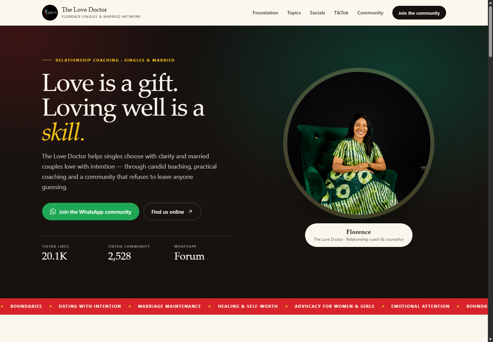

# The Love Doctor

A responsive landing page for **The Love Doctor** and the Florence Singles and Married Global Network Foundation. It introduces the foundation, highlights relationship education and advocacy topics, links visitors to social profiles, and invites people to join the WhatsApp community.

## Screenshots



## What’s on the site

- Foundation and relationship-coaching introduction
- Conversation topics for singles, married couples, women, and girls
- Links to X, TikTok, and the WhatsApp community
- TikTok creator embed with a fallback when the embed cannot load
- Image previews with an accessible lightbox
- Responsive navigation and layouts for smaller screens

## Built with

This is a lightweight static website made with HTML, CSS, and plain JavaScript. It does not require a framework, package installation, or build step. The TikTok feed uses TikTok’s external embed script and needs an internet connection; the rest of the page is local.

## Run locally

Open `index.html` in a browser, or start a small local web server from the project folder. For example, with Python installed:

```bash
python -m http.server 8000
```

Then visit <http://localhost:8000>.

## Project structure

```text
.
├── index.html              # Page content and image references
├── styles.css              # Layout, colors, and responsive styles
├── script.js               # Navigation, image lightbox, and TikTok embed behavior
├── tiktok-videos.js        # Optional list of curated TikTok videos
└── assets/
    ├── logo.jpeg
    ├── love-doctor.jpeg
    ├── tiktok-profile.jpeg
    ├── whatsapp-community.jpeg
    ├── x-profile.jpeg
    ├── originals/           # Preserved copies of the original loose image files
    └── screenshots/         # Desktop and mobile page screenshots
```

The images used by the page live in `assets/`. The copies in `assets/originals/` are the original loose image files, preserved during organization. The five page images were already referenced from `assets/`, so those working paths remain the same.

## Deploy

The site is static and can be hosted on GitHub Pages or any static web host. To use GitHub Pages, push the project and select the repository’s root folder as the Pages source. Keep the `assets/` folder beside `index.html` so the image paths continue to resolve.

